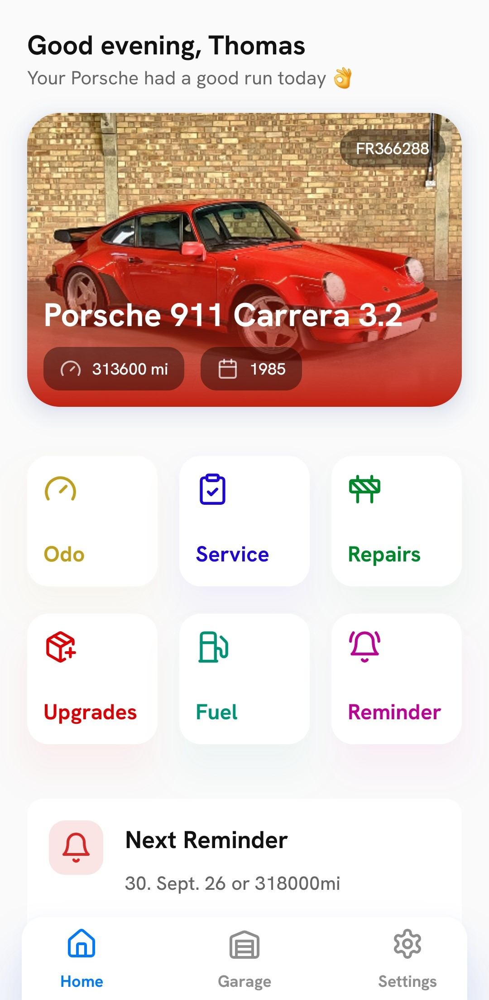
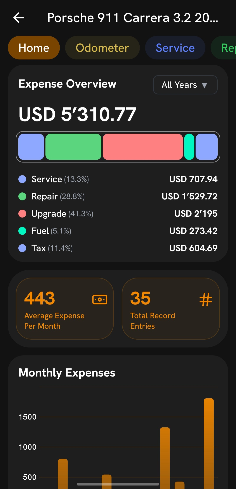
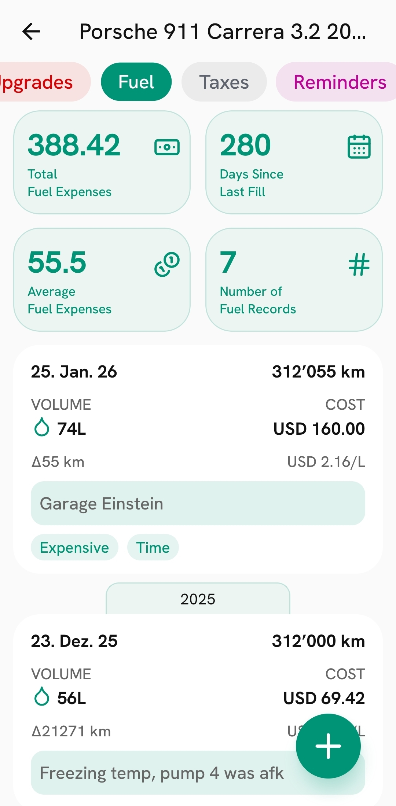
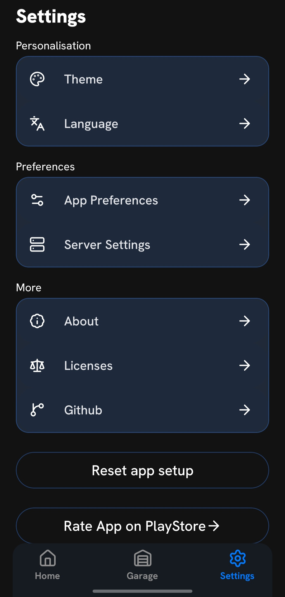

<div align="center">
  

  # Lugelogger Companion

  **Your vehicle records, wherever you go.**

  An independent mobile companion for your self-hosted **Lugelogger** server.

  **Android:** preparing for release · **iOS:** planned
</div>

---

## Overview

Lugelogger Companion brings your vehicle management data to your phone. Connect it to your own Lugelogger server to view vehicle information, log records, review expenses, and keep up with maintenance while you're away from your computer.

The app is a **client**, not a replacement for the Lugelogger server. You need an existing, reachable Lugelogger instance to use it.

> **Project status:** The Android app is approaching its first public release. iOS support is planned but has not yet completed platform-specific testing. Store download links will be added when available.

## Features

- **Vehicle dashboard** — view your vehicles and choose a primary vehicle for quick access.
- **Record management** — create, view, edit, and delete fuel, odometer, service, repair, upgrade, and tax records.
- **Maintenance reminders** — keep track of upcoming vehicle-related tasks.
- **Statistics and expenses** — review vehicle usage, costs, and record summaries.
- **Vehicle images** — display images from your authenticated Lugelogger server.
- **Personal preferences** — configure distance and liquid units, currency display, and US/UK MPG preferences.
- **Light and dark themes** — a mobile interface that adapts to your preferred appearance.
- **Guided setup** — connect to your server, select a primary vehicle, and configure preferences during onboarding.
- **Over-the-air updates** — compatible JavaScript and asset fixes can be delivered through Expo EAS Update without a new store download.

## Screenshots

<p align="center">
  
  
  
  
</p>

## Requirements

- A running **Lugelogger server** that your phone can reach.
- Your server address and valid Lugelogger login credentials.
- An Android device for the currently tested platform.

For access outside your home network, configure your own secure remote access to the server. **HTTPS is recommended**, particularly when using username/password authentication. The app also supports HTTP connections for local or self-hosted setups; avoid exposing an unencrypted server to the public internet.

## Getting started

1. Install Lugelogger Companion when a release build is available.
2. Open the app and follow the onboarding steps.
3. Enter the URL of your Lugelogger server and your login credentials.
4. Select your primary vehicle and preferred units.
5. Start managing your vehicle records.

The app connects to **your** Lugelogger instance; it does not provide a hosted Lugelogger account or server.

## Development

The app is built with **Expo SDK 54**, **React Native**, **TypeScript**, and **Expo Router**.

### Tech stack

| Area | Technology |
| --- | --- |
| Mobile framework | React Native + Expo |
| Navigation | Expo Router / React Navigation |
| Language | TypeScript |
| Server data | Axios + TanStack React Query |
| Local settings | Zustand + MMKV |
| Styling | `twrnc` |
| Animations | React Native Reanimated |
| Lists | FlashList |
| Graphics | React Native Skia |
| Crash reporting | Sentry |
| Product analytics | PostHog |
| OTA delivery | Expo EAS Update |

### Run locally

Install dependencies:

```powershell
npm install
```

Start the Expo development server:

```powershell
npx expo start --dev-client
```

This project uses native modules, so **Expo Go is not sufficient**. Install or build a compatible development client first. For example, with an Android SDK configured:

```powershell
npx expo run:android
```

The first native build may take a while. Subsequent JavaScript changes can usually be tested through the development server.

### Environment variables

Create a local `.env.local` file if you need environment-specific configuration:

```dotenv
# Optional development server fallback
EXPO_PUBLIC_API_URL=http://YOUR_SERVER_ADDRESS

# Telemetry project configuration
EXPO_PUBLIC_POSTHOG_KEY=YOUR_POSTHOG_PROJECT_KEY
EXPO_PUBLIC_POSTHOG_HOST=https://eu.i.posthog.com
```

The app also supports entering server details directly during onboarding, so a hard-coded server URL is not required for normal users.

**Security:** Values prefixed with `EXPO_PUBLIC_` are embedded in the application bundle. Never put real passwords, private API secrets, or a Sentry authentication token in these variables. `SENTRY_AUTH_TOKEN`, when needed for source-map uploads, must be provided securely in the build environment and must not be committed.

## Updates and releases

The project uses **EAS Update** with separate `preview` and `production` channels.

- **Preview:** test OTA changes on a preview-channel build.
- **Production:** deliver verified, compatible updates to installed production builds.

For a preview update:

```powershell
eas update --channel preview --message "Describe the change"
```

For a production update:

```powershell
eas update --channel production --message "Describe the change"
```

**Important:** EAS Update is for changes compatible with the native runtime already installed. Native dependency changes, Expo SDK upgrades, and native configuration changes require a new Android/iOS binary. The app currently uses an `appVersion` runtime policy, so versioning and update compatibility must be managed together.

For **local Gradle release builds** (without EAS Build), the intended update channel must also be included in the native build configuration, such as through `expo.updates.requestHeaders["expo-channel-name"]` before running `expo prebuild`.

## Privacy and diagnostics

Lugelogger Companion connects directly to the Lugelogger server you configure. Server connection settings and app preferences are managed locally on your device.

The app integrates:

- **Sentry** for crash and error diagnostics.
- **PostHog** for aggregate product-usage analytics.

A telemetry preference is available in the app's settings. The telemetry integration uses a randomly generated, pseudonymous identifier rather than your Lugelogger account identity. Manually tracked events are designed to describe actions (such as creating a record) without including server addresses, credentials, vehicle identifiers, or free-text record content.

Before public release, review the app's privacy policy and the actual behavior of all integrated SDKs. Do not treat this README as a substitute for the published privacy disclosure.

## Roadmap

- [ ] Publish the first Android release on Google Play.
- [ ] Complete iOS device testing and TestFlight validation.
- [ ] Publish an iOS release.
- [ ] Continue improving usability, performance, and compatibility based on community feedback.

## Contributing and feedback

Bug reports, suggestions, and contributions are welcome through this repository's **Issues** and **Pull Requests**.

When reporting a bug, include your app version, Android/iOS version, steps to reproduce, and a description of the expected behavior. **Do not include server credentials, authorization headers, private server URLs, license plates, VINs, or other personal vehicle data** in public issues or logs.

## Relationship to Lugelogger

Lugelogger Companion is an **independently developed companion app** for the Lugelogger server project. It is not the server itself. Lugelogger remains a separate project with its own maintainers, documentation, and licensing.

## License

TBD
